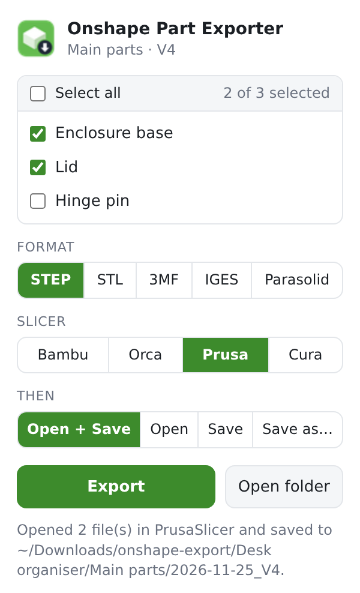

# Onshape → slicer exporter (Bambu Studio, OrcaSlicer, PrusaSlicer, Cura)

A Chrome extension that exports parts from the Onshape Part Studio you have open and sends them straight to **Bambu Studio, OrcaSlicer, PrusaSlicer or UltiMaker Cura**, like Fusion's "Send to 3D print utility". You can also save them into a tidy folder tree, or anywhere you choose.



> **Beta.** Linux with Bambu Studio is tested (Ubuntu, Chrome, Flatpak). OrcaSlicer, PrusaSlicer and Cura support is new. **Windows and macOS support is new and not yet tested on real machines.** Bug reports are very welcome.

## Features

- Pick which parts to export; each part becomes its own file.
- Formats: **3MF**, **STEP**, **STL** (binary, millimetres), plus IGES and Parasolid for other CAD tools.
- Slicer: **Bambu Studio**, **OrcaSlicer**, **PrusaSlicer** or **UltiMaker Cura** (Cura opens STL and 3MF, not STEP).
- Then:
  - **Open + Save:** open in the slicer and keep a copy in the folder tree
  - **Open:** open in the slicer only
  - **Save:** folder tree only
  - **Save as…:** pick any folder
- Folder tree: `Downloads/onshape-export/<document>/<part studio>/<date>_<version>/`. Exporting the same version again moves the older files into `archive/<export time>/` instead of overwriting them.
- Keeps running if you close the popup; the toolbar icon shows `…` / `✓` / `!`.
- Uses your normal Onshape login. No API keys needed.

## Install

You need a Chromium-based browser (Chrome, Edge, Brave, Chromium), Python 3 and at least one of the slicers.

### Windows

1. Install Python 3 from [python.org](https://www.python.org/downloads/) (keep the "py launcher" option ticked).
2. Download this repo (**Code → Download ZIP**) and unzip it somewhere permanent, e.g. `Documents\onshape-bambu-export`.
3. Double-click **`install.bat`**.
4. Open `chrome://extensions` (or `edge://extensions`), turn on **Developer mode**, click **Load unpacked** and pick the `onshape-exporter` folder.

Slicers are found in their default install folders. If yours is elsewhere, set `BAMBU_STUDIO`, `ORCA_SLICER`, `PRUSA_SLICER` or `ULTIMAKER_CURA` to the full path of its `.exe`.

### macOS

1. Install Python 3 from [python.org](https://www.python.org/downloads/) (the built-in `python3` often only offers to install developer tools).
2. In Terminal:
   ```bash
   git clone https://github.com/Globiii/onshape-bambu-export.git ~/onshape-bambu-export
   cd ~/onshape-bambu-export
   ./install.sh
   ```
3. Load the `onshape-exporter` folder as an unpacked extension (see the Windows steps).

Slicers are found in `/Applications` or `~/Applications` (`BambuStudio.app`, `OrcaSlicer.app`, `PrusaSlicer.app`, `UltiMaker Cura.app`). The first export may make macOS ask whether the slicer may access your Downloads folder; allow it.

### Linux

```bash
git clone https://github.com/Globiii/onshape-bambu-export.git
cd onshape-bambu-export
./install.sh
```

Then load the `onshape-exporter` folder as an unpacked extension. "Save as…" uses `zenity` (preinstalled on Ubuntu). Slicers are found as a Flatpak, a snap/distro package on your PATH, or an AppImage in `~/Applications`; otherwise set `BAMBU_STUDIO`, `ORCA_SLICER`, `PRUSA_SLICER` or `ULTIMAKER_CURA` to its path.

### What the installer does

It registers a small helper (`bambu_host.py`) with your browsers. Browsers can't write into your folders or start programs themselves, so the helper does that. It only accepts messages from this extension, and it only writes 3D/CAD files into the export folder or the folder you pick. If you move the folder, run the installer again.

## How it works

The popup runs Onshape API calls inside your open Onshape tab, so they use your existing session. Each part is exported through Onshape's translation service, and the files are passed to the helper over Chrome native messaging. Onshape always writes STL in metres, so the extension rescales STL files to millimetres.

## Uninstall

Remove the extension in your browser, then run `python install.py --uninstall` (Windows: `py install.py --uninstall`).

## Disclaimer

Unofficial hobby project. Not affiliated with or endorsed by Onshape / PTC Inc., Bambu Lab, the OrcaSlicer project, Prusa Research or UltiMaker. Use at your own risk.

## License

MIT, see [LICENSE](LICENSE).
